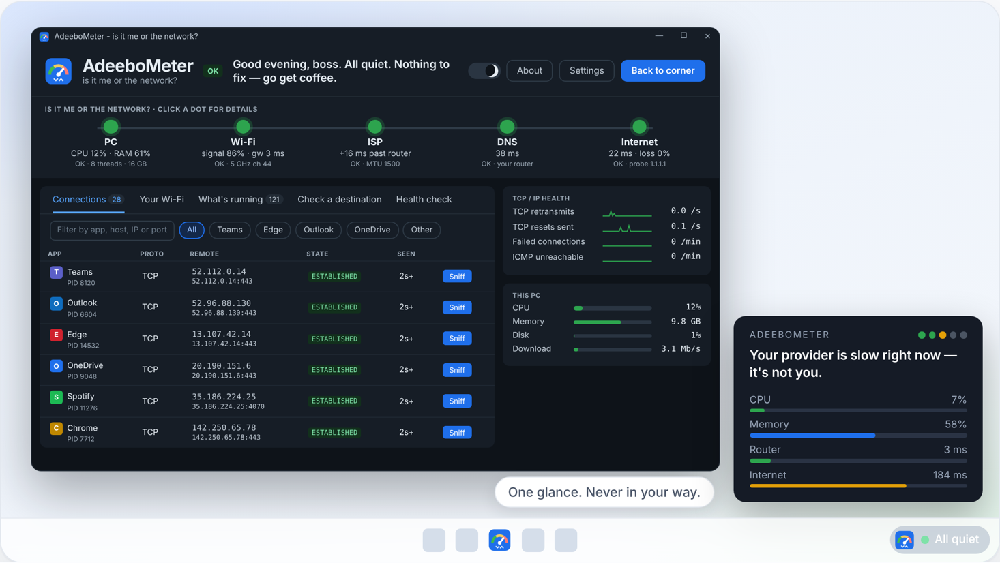

<h1 align="center">AdeeboMeter</h1>

<b>Free, offline network troubleshooter and monitor for Windows 10 and 11 — no admin rights, no cloud.</b> Is it your PC, your Wi-Fi, your router, your ISP, DNS or the internet? One glance tells you.

<b><a href="https://adeeb111.github.io/AdeeboMeter/">Website</a></b> · <a href="https://github.com/adeeb111/AdeeboMeter/releases/latest">Download</a> · <a href="https://adeeb111.github.io/AdeeboMeter/#theory">Theory of Everything</a> · <a href="https://github.com/adeeb111/AdeeboMeter/discussions">Discussions</a>

**Is it me or the network?** One glance tells you.

AdeeboMeter is a small Windows companion for people who live on the network. A faded card in the corner of your screen tells you — in one plain sentence — whether your PC, your Wi-Fi, your provider, DNS or the internet is the problem, and what to do about it. When something is really wrong, one click opens an engineer view with everything you'd otherwise dig out of Task Manager, `ping`, `tracert`, `netsh` and Wireshark.

> **No cloud. No telemetry. Never listens.** Every packet it sends is listed in *About* — and you can switch each one off.

## What it does

- **Corner widget** — faded (30 % by default, up to 100 %), small or a little bigger, never takes clicks, folds away behind your windows. A verdict in one sentence and five dots from your PC to the internet.
- **Overview** — the verdict, router / internet / DNS / traffic right now, what needs attention, and today.
- **Monitor** — every connection and the app that owns it (*Sniff* a row into Wireshark); your Wi-Fi or cable (a health score that works even when IT turned location off, an advisor, look-alike networks, a walk test, your switch port and VLAN); every program explained; live capture.
- **Investigate** — **What's wrong?** when you can't name it: layer by layer from your PC to the internet, stopping at the first broken one. Or pick the problem (*slow*, *won't open*, *calls freeze*, *keeps disconnecting*, *works at home but not on VPN*, *my PC is slow*) and it runs the checks: **Finding · What I observed · Not established · Next test**. Plus Check a destination (DNS → route → TCP → TLS → HTTP → MTU → trace, and the path story) and a health check.
- **Security** — one checkup, 42 defensive checks of this PC, your network and your sites (firewall, BitLocker, updates, SMBv1, RDP, open ports, added root certificates, ARP spoofing signs, rogue DHCP, router UPnP, certificate expiry, SPF / DMARC…). Reads only; each fix opens the Windows screen where you change it.
- **Toolbox** — 100+ tools (103) in four sections (Network · Devices · Traffic Lab · Windows) with quick buttons on every page, found by typing (*mtu*, *dns*, *wifi*, *slow*…) or with the keyboard (F1 explains anything), each result one click from your clipboard or saved as .txt / .csv: MTU per hop, MTR, the way back, which route, your gateway (VRRP / HSRP failover), routing protocols on your segment, IPv6; port test, TCP ping, HTTP timing, proxy, Teams UDP, SSH, mail, RADIUS, TACACS+; an iperf3 client, latency under load (bufferbloat), sustained ping, DSCP-marked ping, TWAMP-light; dig (HTTPS / SVCB, DNSSEC, TLSA, over DoH), encrypted DNS, NTP; neighbours (ARP), DHCP lease, Wi-Fi roams, who announces itself (mDNS / SSDP / LLMNR), syslog, your own router (hairpin), ping sweep, Wake-on-LAN, subnet calculator; Windows' own evidence, 802.1X, domain controllers, Group Policy, expiring certificates, firewall rules, what's listening, the event log; and the PC — memory, disk, heat, frozen windows, leaks, crashes, battery, where the space went. Type a target once; run again and compare.
- **Network story** — follow any app from your PC to the server, box by box, and see where the time goes.
- **Time machine** — replay any minute of the last days (network and PC side by side), the week as a heatmap, data usage per network, after-call summaries, new devices on your network.
- **Traffic Lab** — test traffic you build yourself: ICMP (size, DF, TTL), UDP and TCP payloads, ARP who-has, DHCP options, a test trap, a NetFlow record, Wake-on-LAN, iperf3 — one target, capped at 10 packets a second.
- **SNMP, read-only** — v2c and v3 (auth and AES privacy): a one-click snapshot, interfaces with problems first and what changed since your last run, find a MAC, VLANs, PoE, LAG, printers and UPSes, traffic per port, CPU and memory, LLDP neighbours, sensors, and a walk of any OID rebuilt into named tables. Drop your vendor's MIBs in a folder; search them for *temperature* or *optic* and walk that table in one click. It never sets anything and never listens for traps.
- **Learn** — 46 topics, two lines and a picture each, from *the layers in plain words* to *svchost*; inside Windows (who started whom, what starts with Windows).
- **Every fact says where it came from** — measured, Windows-reported, seen in packets, inferred or unavailable. **Details** adds the raw values.
- Hover anything with a **?** cursor for an explanation; **Ctrl+K** jumps to anything.

## Get it

**[adeeb111.github.io/AdeeboMeter](https://adeeb111.github.io/AdeeboMeter/)** — download, and the Theory of Everything as slides.

1. Download `AdeeboMeter-<version>-win64.zip` from [Releases](../../releases) and open it.
2. Double-click **AdeeboMeter.exe** and choose **Install**. (SmartScreen: *More info → Run anyway* — the exe isn't code-signed yet.)
3. Look at the bottom-right corner of your screen.

It installs just for you — `%LOCALAPPDATA%\Programs\AdeeboMeter\<version>`, a Start menu entry and an entry in
Settings > Apps — with no administrator rights. **Update**: run the new exe, choose *Update*; your settings come along.
**Remove**: Settings > Apps, or the tray menu. Rather not install? Choose *Just run it from here*.

Windows 10 or 11. **Download it only from [github.com/adeeb111/AdeeboMeter](https://github.com/adeeb111/AdeeboMeter/releases)** —
fake copies of network tools are a favourite trick of malicious ads. The exe is built by GitHub Actions on a clean Windows
machine with Microsoft's own .NET Framework compiler from this exact source; each release lists its SHA256, and GitHub's
build provenance proves where a file came from: `gh attestation verify AdeeboMeter.exe -R adeeb111/AdeeboMeter`.

**Build it yourself** (nothing to install — the compiler ships inside Windows): double-click **`build_exe.cmd`**.
Releases are packaged by `release.ps1` and tagged `v<version>`; what changed is in [CHANGELOG.md](CHANGELOG.md).

## Use it

| To… | Do this |
|---|---|
| Open the engineer view | Click the tray icon, or press **Ctrl+Alt+A** |
| Go back to the corner | **Esc**, minimise, the X, or *Back to corner* |
| Quit completely | Right-click the tray icon → **Exit** (nothing keeps running) |
| Day / night | The sun/moon switch in the header |
| Raw values and sources | **Details** in the header |
| Jump to anything | **Ctrl+K** |
| Tune how much it watches | **Settings** → Penny / Balanced / Engineer |
| Bigger corner widget | Tray menu → **Bigger widget** |

## Privacy and security

- Never listens on a port (it checks itself at every start), no cloud, no account, no telemetry, no updater.
- Tests and tools run only when you press them, and contact only what you typed or what they name on screen.
- **Online lookups** (BGP and network owners) are off by default; switched on, they run for 5 minutes to 3 hours, then turn themselves off. They send public IP addresses only, to RIPEstat and PeeringDB.
- History, data usage and what's normal stay on your PC and delete themselves (3 days by default).
- No admin rights; no shell; tools run by full System32 path; inputs validated; capture paths fenced in; DLLs load only from System32.
- TLS 1.2/1.3 only with Windows' certificate validation.
- Builds clean against Microsoft's .NET security and quality analyzers with every rule on.
- `AdeeboMeter.exe --selftest` runs 30 checks, including "never listens", leak tests and parser tests. `--deeptest` feeds every tool hostile input, repeats them to catch leaks and stresses the UI.

## Code signing policy

Releases aren't code-signed yet; we're applying for free signing for open-source projects from [SignPath Foundation](https://signpath.org). Until then, and after:

- Every release file is built by this repository's GitHub Actions workflow from the public source — nothing built on a personal PC is ever published. Every action in the workflow is pinned to an exact commit.
- Each release carries SHA-256 fingerprints and GitHub build provenance.
- Each release is approved by hand.

**Team roles:** committer, reviewer and approver — [adeeb111](https://github.com/adeeb111). Multi-factor authentication is on for GitHub.

## Privacy policy

AdeeboMeter will not transfer any information to other networked systems unless you ask it to.

- It never listens for connections, has no telemetry, no account and no updater.
- Checks and tools you start contact only the address you typed, or the one the tool names on screen. *About* lists live every packet your current settings send, and each can be switched off.
- *Online lookups* are off by default. Switched on, they send public IP addresses only (never your private addresses or the names you typed) to [RIPEstat](https://www.ripe.net/about-us/legal/ripe-ncc-privacy-statement/) and [PeeringDB](https://www.peeringdb.com/aup) over HTTPS, and turn themselves off after the time you choose.
- Everything AdeeboMeter remembers stays on your PC; removing the app (Settings > Apps) removes it.

## How it works

Read **[The Theory of Everything](docs/THEORY-OF-EVERYTHING.md)** — every part of the code explained in plain words.

## Feedback and help

[Report a problem](https://github.com/adeeb111/AdeeboMeter/issues/new/choose) · [Ideas & questions](https://github.com/adeeb111/AdeeboMeter/discussions) · [Contributing](CONTRIBUTING.md) · [Security](SECURITY.md) · [Changelog](CHANGELOG.md)

---

## Donate

AdeeboMeter is free. If it saved you time, you can **[donate](https://paypal.me/adeeb1111)** to cover the cost to keep this app free and running: [$5](https://paypal.me/adeeb1111/5CAD) · [$10](https://paypal.me/adeeb1111/10CAD) · [$20](https://paypal.me/adeeb1111/20CAD) · [$50](https://paypal.me/adeeb1111/50CAD) · [other amount](https://paypal.me/adeeb1111) (PayPal, Canadian dollars).

Created by Adeeb Khan · [MIT License](LICENSE) — free to use, change and share; keep the copyright notice.
